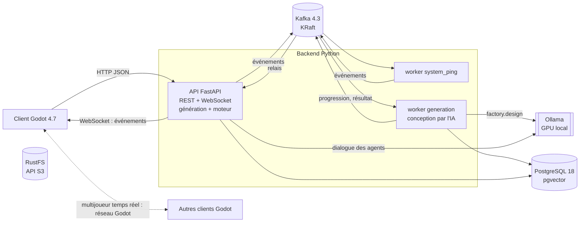

# Architecture

État (2026-11-06) : comptes et rôles, deux packs de jeu (l'usine, `ai/packs/usine.yaml`, est le pack principal ;
l'atelier, `ai/simulation.yaml`, est gelé), conception du jeu par l'IA (tâche `factory.design`, docs/decisions/0008
et 0010) avec repli par paramètres (docs/decisions/0006), régénération d'une section (docs/decisions/0012, statut
« proposé » dans l'ADR), moteur hebdomadaire, groupes d'équipes (docs/decisions/0011), « prêt », pause et aléa du
formateur, lobbies, agents PNJ à mémoire, client Godot et présence multijoueur sont en place. L'ingestion RAG
passe par `.\scripts\ingest.ps1` (pas de worker `rag`).

## Briques

| Brique | Rôle | Code |
|---|---|---|
| Client Godot | Menus (formateur, joueur, admin), monde 3D, rendu d'une spec en lobby, PNJ | `godot/` |
| API FastAPI | Point d'entrée unique du client : authentification, rôles, CRUD, publication des commandes, relais WebSocket | `backend/gmix/api` |
| Kafka | Commandes et événements asynchrones, traitements IA, journal des parties | `backend/gmix/messaging` |
| Workers | Consommateurs Kafka : `generation` (conception des jeux par l'IA, groupe `worker-generation`) et `system_ping` (diagnostic) ; lancement : `.\scripts\worker.ps1 <nom>` | `backend/gmix/workers` |
| PostgreSQL + pgvector | Comptes, lobbies et état des parties, specs de business games, mémoire des agents, corpus RAG (vecteurs + plein texte), catalogue d'assets, cache LLM | `backend/gmix/db` |
| RustFS (S3) | Fichiers : assets 3D, documents sources du RAG, exports | `backend/gmix/storage.py` |
| Ollama | Modèles locaux, appelés uniquement via le catalogue de tâches | `backend/gmix/llm` |

## Flux 1 : le formateur crée un business game

Deux chemins, même résultat (une spec validée par `gmix.game.spec.SimSpec`, jouée en pilote automatique) :

| Chemin | Route | Déroulé |
|---|---|---|
| Par l'IA (usine seulement) | `POST /api/v1/games/designs` (202) | le jeu passe en `generating` et un job est créé ; commande `generation.requested` sur `gmix.generation.commands` ; le worker `generation` appelle la tâche `factory.design` (brief -> `GameParams`, 2 réparations puis repli sur `default_params`), assemble la spec par `gmix.game.generation.generate`, la contrôle, puis passe le jeu en `draft` ; `generation.progress` / `completed` / `failed` sur `gmix.generation.events` (non relayés au WebSocket) ; le client suit le job par `GET /games/{id}/job` (étape, pourcentage, place dans la file) |
| Par paramètres (repli, atelier) | `POST /api/v1/games` | `generate` assemble la spec sans modèle ; réponse 201 en moins d'une seconde |

Ensuite : relecture (partie de référence comprise), retouches du plan (`PUT /games/{id}/layout`), régénération
d'une section (`POST /games/{id}/design/regenerate`, worker, retour en `draft`), `POST /games/{id}/publish`
(`ready`), puis le formateur crée un groupe d'équipes (`POST /groups`, une équipe = un lobby) ou un lobby, et
obtient un code d'accès. Détail des routes et des droits : docs/roles.md.

## Flux 2 : un joueur parle à un agent (latence visible)

1. Message -> API -> tâche `player.intent` (tev1) : hors-sujet et injection reçoivent une réponse fixe.
2. Faits de la semaine de l'agent (`engine.public_state()["briefings"]`) + six derniers échanges du lobby
   avec lui (`npc_memories`) + extraits RAG pour une question de fond -> tâche `npc.dialogue` -> une ou deux
   phrases. L'échange est enregistré, puis publié sur `gmix.npc.transcripts`. Kafka n'est pas sur ce chemin.

## Flux 3 : partie multijoueur (en salle ou à distance)

- Positions et animations : un serveur Godot headless par lobby, autoritaire, transport ENet en salle ou
  WebSocket sur 443 à distance (docs/decisions/0005). Kafka et FastAPI ne sont pas faits pour 20 à 60 mises
  à jour par seconde.
- Actions et semaines : l'API applique les règles (`gmix.game.engine`, fonctions pures, sous verrou de ligne
  sur le lobby) et répond tout de suite au joueur ; `lobby.state` sur `gmix.game.events` diffuse l'état aux
  autres membres par WebSocket et garde le journal. Pas de worker de simulation : une semaine simulée prend
  quelques millisecondes, et le joueur voit l'erreur de règle immédiatement.
- Présence : `POST /lobbies/{id}/presence` lance au besoin le serveur Godot du lobby (`gmix.game.servers`,
  ports GAME_SERVER_PORTS) et remet un ticket de 60 s ; le serveur vérifie sa signature (HS256, JWT_SECRET
  transmis par variable d'environnement) puis relaie les positions à 10 Hz.
- Modes de déploiement : en salle, toute la pile sur une machine du réseau local (`.\scripts\api.ps1 -Lan`) ;
  à distance, sur un serveur derrière un reverse proxy HTTPS. Seuls l'API et les serveurs de partie sont exposés.

## Mondes et assets

L'IA ne crée jamais de géométrie : elle choisit des paramètres dans les listes du pack, et le placeur
(`gmix.game.layout`, sans hasard, ADR 0009) pose les objets du catalogue `ai/assets.yaml` sur les grilles du
pack, contrôlés par les règles de placement (`check_placement`).

| Pack | Monde (`spec.world`) | Statut |
|---|---|---|
| Usine (`ai/packs/usine.yaml`) | hall de 48 x 30 m en U, 11 départements dont 2 externes (fournisseur, client) reliés par des routes, 1 à 3 lignes de 4 machines, semaine simulée minute par minute (`gmix.game.factory`) puis rejouée en 3D | principal |
| Atelier (`ai/simulation.yaml`) | hall de 32 x 24 m repris du jeu de référence ; postes et trajets des agents dans les allées libres (vérifiés par les tests) | gelé, gardé en repli |

Godot construit le monde puis l'anime avec l'état public (indicateurs, alertes des agents, chronologie de la
semaine pour l'usine).

## Choix structurants

Voir docs/decisions/ :

| ADR | Sujet |
|---|---|
| 0001 | stockage RustFS |
| 0002 | Kafka hors temps réel |
| 0003 | catalogue de tâches IA |
| 0004 | comptes locaux |
| 0005 | jeu local et à distance |
| 0006 | business games simulés par paramètres |
| 0007 | packs de domaine et usine 3D |
| 0008 | conception du jeu par l'IA sur un moteur déterministe |
| 0009 | monde sur grilles et réseau logistique |
| 0010 | refonte alignée sur Business_game (génération, lobby, jeu, débrief) |
| 0011 | groupes d'équipes dans un lobby, connexions déclaratives, dépôt de travail |
| 0012 | tranche B4 : régénération par section, débrief en courbes (statut « proposé ») |
